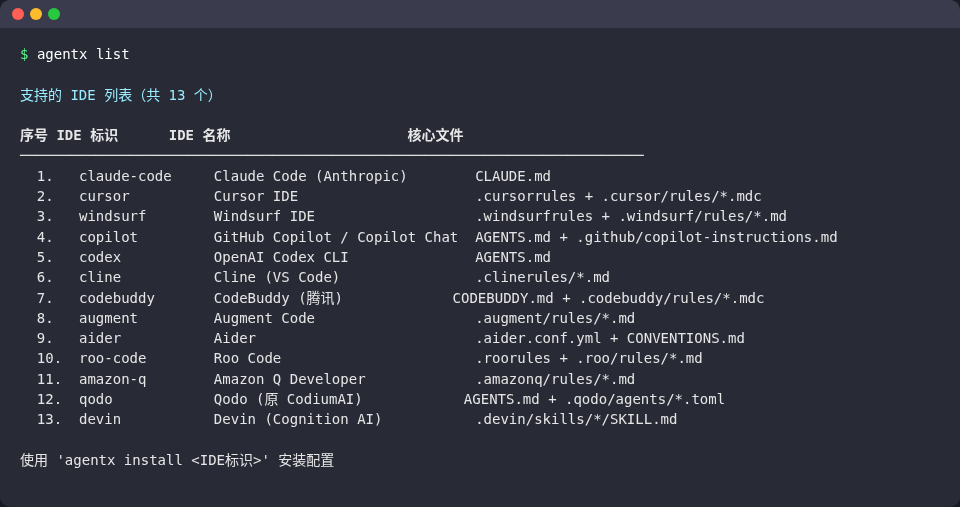
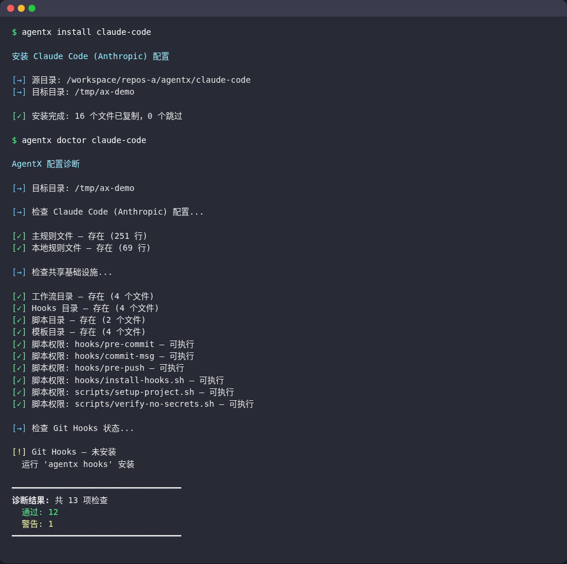

# AgentX — complete runtime infrastructure for AI agents across IDEs

> Complete rules, workflows, skills, memory system, tool chains and automation configs for AI coding agents.
> Organized per IDE, self-contained, drop straight into your project.
> Modeled on Devin AI's full working rules and runtime behaviour.

[简体中文](README.md) · **English**

> The rule files themselves are written in Chinese.

## Supported IDEs / AI tools

| Directory | IDE / tool | Core files | How to install |
|------|-----------|---------|---------|
| `claude-code/` | Claude Code (Anthropic) | `CLAUDE.md` | copy to project root |
| `cursor/` | Cursor IDE | `.cursorrules` + `.cursor/rules/` | copy to project root |
| `windsurf/` | Windsurf (Cascade) | `.windsurfrules` + `.windsurf/rules/` | copy to project root |
| `copilot/` | GitHub Copilot | `AGENTS.md` + `.github/` | copy to project root |
| `codex/` | OpenAI Codex CLI | `AGENTS.md` | copy to project root or `~/.codex/` |
| `devin/` | Devin | `.devin/skills/` | copy into the repo and git push |
| `cline/` | Cline (VS Code) | `.clinerules/` | copy to project root |
| `codebuddy/` | CodeBuddy (Tencent Cloud) | `CODEBUDDY.md` + `.codebuddy/rules/` | copy to project root |
| `augment/` | Augment Code | `.augment/rules/` | copy to project root |
| `aider/` | Aider | `.aider.conf.yml` + `CONVENTIONS.md` | copy to project root |
| `roo-code/` | Roo Code | `.roo/rules/` | copy to project root |
| `amazon-q/` | Amazon Q Developer | `.amazonq/rules/` | copy to project root |
| `qodo/` | Qodo (formerly Qodo Gen) | `AGENTS.md` + `.qodo/agents/` | copy to project root |

## Quick start

### Option 1: CLI (recommended)

```bash
# Install the agentx CLI
curl -fsSL https://raw.githubusercontent.com/gatesenman/agentx/main/cli/install.sh | bash

# List supported IDEs
agentx list

# Install configs into your project (rule files + workflows + scripts + hooks)
cd /your/project
agentx install claude-code           # Claude Code
agentx install cursor                # Cursor
agentx install claude-code cursor    # several IDEs at once

# Install Git hooks
agentx hooks

# Scan for leaked secrets
agentx scan

# Check that the configuration is correct
agentx doctor claude-code

# More commands
agentx help
```

### Option 2: copy manually

```bash
# Clone this repository
git clone https://github.com/gatesenman/agentx.git

# Copy the files for your IDE into your project
# e.g. Claude Code
cp agentx/claude-code/CLAUDE.md /your/project/

# e.g. Cursor
cp agentx/cursor/.cursorrules /your/project/
cp -r agentx/cursor/.cursor /your/project/

# e.g. Windsurf
cp agentx/windsurf/.windsurfrules /your/project/
cp -r agentx/windsurf/.windsurf /your/project/

# e.g. GitHub Copilot / Codex
cp agentx/copilot/AGENTS.md /your/project/

# Install Git hooks (optional, works for every IDE)
cd /your/project && bash agentx/claude-code/hooks/install-hooks.sh
```

## Screenshots

Real terminal output of the CLI run in an empty project (`cli/agentx`, ANSI output recorded with `script` and rendered to an image; the CLI prints Chinese messages):





## What each IDE directory contains

Every IDE directory is **self-contained** and carries the full agent runtime infrastructure:

```
<ide>/
├── core rule file(s)                      # main rules the IDE loads automatically
│
├── workflows/                             # workflow playbooks
│   ├── PLAYBOOK-bug-fix.md               #   bug fix end-to-end (219 lines)
│   ├── PLAYBOOK-feature-implementation.md #   feature implementation (210 lines)
│   ├── PLAYBOOK-ci-fix.md                #   CI fix (240 lines)
│   └── PLAYBOOK-refactoring.md           #   refactoring (200 lines)
│
├── hooks/                                 # Git hooks (complete executable bash)
│   ├── pre-commit                        #   secret detection + lint + type check (185 lines)
│   ├── commit-msg                        #   Conventional Commits validation (88 lines)
│   ├── pre-push                          #   branch protection + tests + build (124 lines)
│   └── install-hooks.sh                  #   one-command installer (73 lines)
│
├── scripts/                               # runnable scripts
│   ├── setup-project.sh                  #   automatic project setup (274 lines)
│   └── verify-no-secrets.sh              #   deep scan for 10 kinds of secrets (212 lines)
│
├── templates/                             # config templates
│   ├── environment.yaml                  #   Devin environment blueprint
│   ├── pr-template.md                    #   PR description template
│   ├── pre-commit-config.yaml            #   .pre-commit-config.yaml template
│   └── gitignore.template                #   safe .gitignore template
│
├── MCP-TOOLS-REFERENCE.md                 # reference for 50+ tools (445 lines)
├── MEMORY-SYSTEM.md                       # 7-layer memory architecture (303 lines)
├── SKILLS-REFERENCE.md                    # skill system reference (255 lines)
├── DECISION-TREES.md                      # 10 decision trees (361 lines)
├── AUTOMATIONS-REFERENCE.md               # automation and hook config reference (321 lines)
├── TROUBLESHOOTING.md                     # troubleshooting guide
├── PROMPT-PATTERNS.md                     # prompt patterns and best practices
├── TOOL-CHAINS.md                         # end-to-end tool-chain orchestration
└── README.md                              # IDE-specific install notes
```

## Rule coverage (15 domains)

| Domain | Description |
|--------|------|
| Core principles | persistence, thoroughness, independence, inferring intent |
| Code quality | minimal edits, follow conventions, type safety, no `Any` |
| Code comments | no comments by default, don't comment diffs, match style |
| Git rules | branch naming, commit conventions, 13 forbidden operations |
| PR workflow | creation, description template, CI fixes, draft PRs, multiple PRs |
| Task management | TODO lists, status tracking, never drop tasks |
| Repo setup | follow the README, monorepos, multiple languages, environment detection |
| Debugging | reproduce → locate → root cause → fix → verify |
| Testing | golden path, recorded evidence, end-to-end verification |
| Security | secret protection, sensitive file checks, defensive security |
| Communication | concise, high signal, links first |
| Credentials | three-option protocol, batched requests |
| Error handling | infrastructure vs task-level errors, retry strategy |
| Conflict resolution | resolve simple ones autonomously, escalate complex ones, progress updates |
| Professional standards | technical accuracy first, strict equality |

## Tool chains and infrastructure

| Category | Contents |
|------|---------|
| Workflows | 4 complete playbooks, 6–8 steps each, with commands, decision branches and templates |
| MCP tools | docs for 50+ tools: files, shell, Git, browser, deployment, knowledge management |
| Memory system | 7 layers: session → knowledge → skills → playbooks → blueprints → secrets → browser |
| Skill system | 8 built-in skills + custom skill template + execution rules |
| Decision engine | 10 decision trees: task routing, tool choice, parallel/serial, errors, Git, PRs, communication |
| Automation | 4 event-driven automations + 3 Git hooks + scheduled tasks |
| Scripts | automatic project setup (detects type / package manager / monorepo) + deep secret scan |
| Templates | environment blueprint, PR description, pre-commit config, .gitignore |
| Troubleshooting | systematic guides for environment issues, CI failures, performance, Git conflicts |
| Prompt patterns | 10 effective prompt patterns + anti-patterns |
| Tool-chain orchestration | end-to-end call sequences for 30+ scenarios |

## Cross-tool compatibility

| Tool | Native format | Also reads |
|------|---------|-----------|
| Codex | `AGENTS.md` | — |
| Cline | `.clinerules/` | `.cursorrules`, `.windsurfrules`, `AGENTS.md` |
| CodeBuddy | `CODEBUDDY.md` | `AGENTS.md` |
| Augment | `.augment/rules/` | `CLAUDE.md`, `AGENTS.md` |
| Qodo | `AGENTS.md` | — |
| Roo Code | `.roo/rules/` | — |

If several AI tools are used on one project, a single `AGENTS.md` is recognized by most of them.

## Repository structure

```
<ide>/        13 IDE / tool directories (claude-code, cursor, windsurf, copilot, codex, devin, cline, codebuddy, augment, aider, roo-code, amazon-q, qodo), each self-contained
cli/          the agentx CLI (bash script agentx, one-line installer install.sh, CLI docs)
docs/         usage guide, customization, workflows, migration, FAQ, best practices
wiki/         wiki pages
```

## Configuration

The `agentx` CLI reads two environment variables:

| Variable | Description |
| --- | --- |
| `AGENTX_SOURCE` | Local config source directory (e.g. a clone of this repo); when set, nothing is fetched from the network |
| `AGENTX_CACHE_DIR` | Cache directory, default `~/.agentx`; without a source directory the repo is cloned to `$AGENTX_CACHE_DIR/repo` |

Running `cli/agentx` from inside a clone automatically uses the repo root as the source.

## Documentation

| Document | Contents |
|------|------|
| `cli/README.md` | full CLI documentation |
| `docs/USAGE-GUIDE.md` | usage guide for all 13 IDEs |
| `docs/CUSTOMIZATION.md` | customizing the rules |
| `docs/WORKFLOWS-GUIDE.md` | workflow details |
| `docs/MIGRATION.md` | migrating between IDEs |
| `docs/FAQ.md` | FAQ |
| `docs/BEST-PRACTICES.md` | best practices and anti-patterns |
| `wiki/` | wiki pages |

All of these documents are in Chinese.

## Contributing

Issues and pull requests are welcome. When you change one IDE's rules, check the matching content in the other IDE directories too, and run `agentx install <ide>` and `agentx doctor <ide>` in an empty project to verify the result.

## License

MIT
